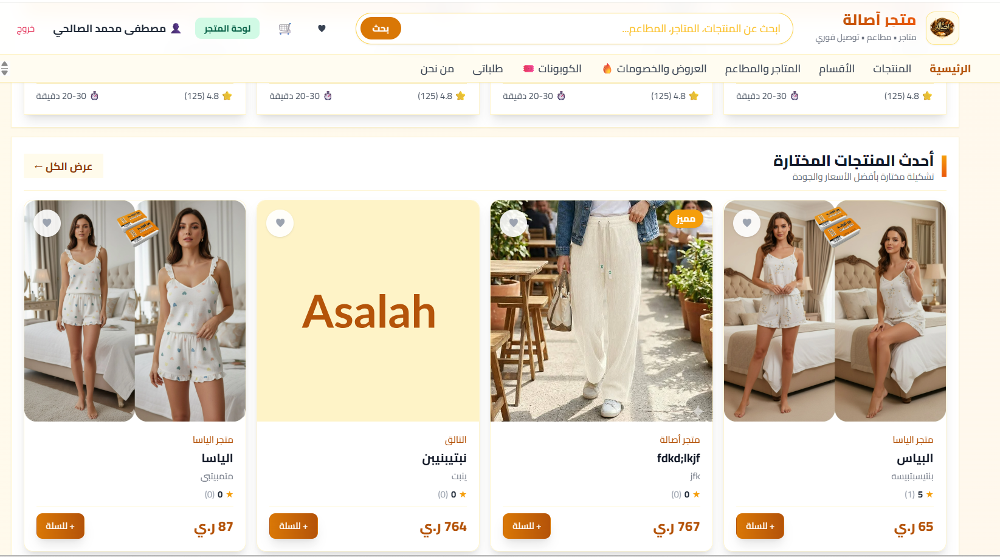
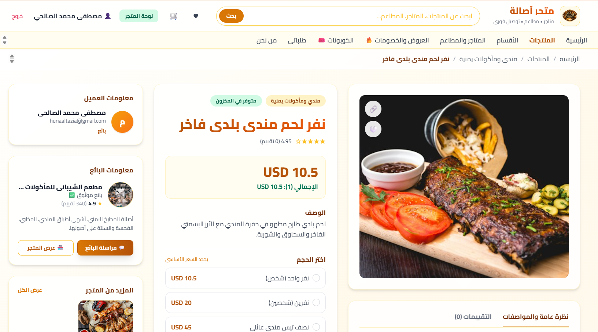
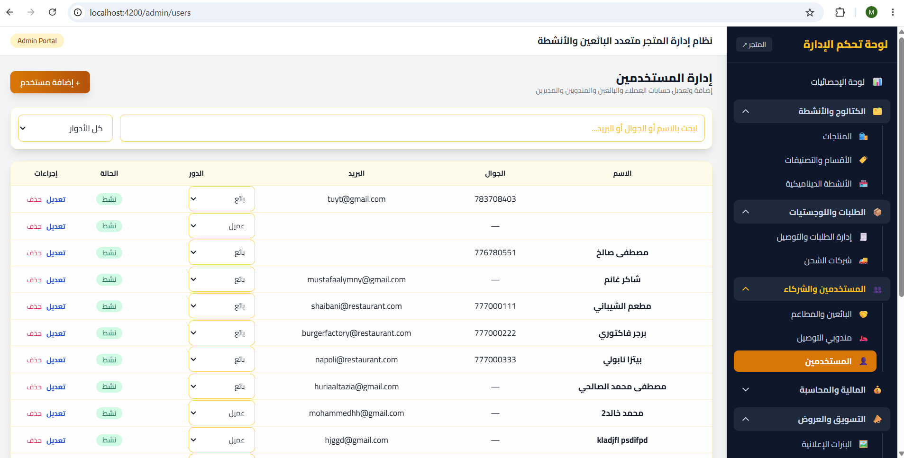
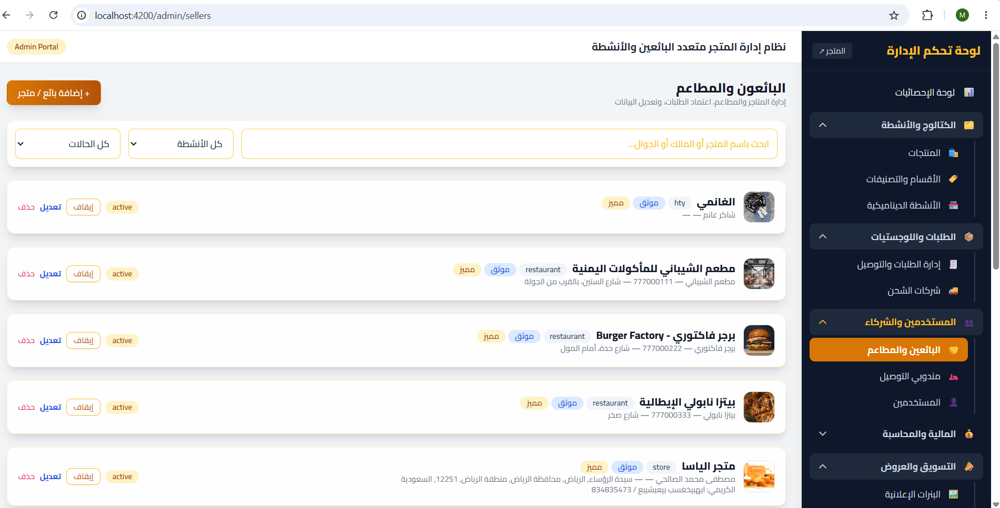

# Shopping Platform — Multi-Vendor E-Commerce & Delivery Ecosystem


منصة تجارة إلكترونية وتوصيل متكاملة **متعددة البائعين والأنشطة** (متاجر، مطاعم، أنشطة تجارية متنوعة)، تم بناؤها وتنظيمها وفق معمارية برمجية حديثة (**Clean Architecture + Feature-Based Architecture**) في كلٍ من الواجهة الخلفية (**ASP.NET Core 8**) والواجهة الأمامية (**Angular 18**)، لتدعم دورة العمل الكاملة من التسوق والدفع حتى التجهيز والتوصيل والتدقيق المالي والتقارير.

---

## لقطات من النظام (Platform Screenshots)

### 1. واجهة المتجر والتسوق (Storefront & Catalog)
<table>
  <tr>
    <td width="50%" align="center">
      <strong>الصفحة الرئيسية — المتاجر والأنشطة</strong><br/>
      
    </td>
    <td width="50%" align="center">
      <strong>قسم المطاعم والوجبات</strong><br/>
      
    </td>
  </tr>
  <tr>
    <td width="50%" align="center">
      <strong>كتالوج المنتجات — العرض الأول</strong><br/>
      
    </td>
    <td width="50%" align="center">
      <strong>كتالوج المنتجات — التصفية والبحث</strong><br/>
      
    </td>
  </tr>
  <tr>
    <td width="50%" align="center">
      <strong>تفاصيل المنتج والمتغيرات</strong><br/>
      
    </td>
    <td width="50%" align="center">
      <strong>تفاصيل المنتج — الخيارات والتقييمات</strong><br/>
      
    </td>
  </tr>
</table>

### 2. رحلة العميل: السلة، الدفع الخرائطي، وتتبع الطلب (Cart, Checkout & Tracking)
<table>
  <tr>
    <td width="50%" align="center">
      <strong>سلة التسوق</strong><br/>
      
    </td>
    <td width="50%" align="center">
      <strong>تتبع حالة الطلب</strong><br/>
      
    </td>
  </tr>
  <tr>
    <td width="50%" align="center">
      <strong>إتمام الطلب وتحديد الموقع على الخريطة</strong><br/>
      
    </td>
    <td width="50%" align="center">
      <strong>ملخص الفاتورة وخيارات الدفع</strong><br/>
      
    </td>
  </tr>
</table>

### 3. لوحة تحكم الإدارة (Admin Portal)
<table>
  <tr>
    <td width="50%" align="center">
      <strong>لوحة الإحصائيات والقيادة العامة للمدير</strong><br/>
      
    </td>
    <td width="50%" align="center">
      <strong>مراجعة وتأكيد طلبات الدفع والتحويلات</strong><br/>
      
    </td>
  </tr>
  <tr>
    <td width="50%" align="center">
      <strong>إدارة الطلبات والتوصيل</strong><br/>
      
    </td>
    <td width="50%" align="center">
      <strong>إدارة المنتجات</strong><br/>
      
    </td>
  </tr>
  <tr>
    <td width="50%" align="center">
      <strong>إدارة المستخدمين والبائعين والمندوبين</strong><br/>
      
    </td>
    <td width="50%" align="center">
      <strong>إدارة المستخدمين والبائعين والمندوبين — تفاصيل</strong><br/>
      
    </td>
  </tr>
</table>

### 4. لوحة تحكم البائع وبوابة المندوب (Seller & Driver Portals)
<table>
  <tr>
    <td width="50%" align="center">
      <strong>لوحة إحصائيات وأرباح البائع</strong><br/>
      
    </td>
    <td width="50%" align="center">
      <strong>لوحة إحصائيات مندوب التوصيل</strong><br/>
      
    </td>
  </tr>
  <tr>
    <td colspan="2" align="center">
      <strong>بوابة المندوب — إدارة طلبات التوصيل</strong><br/>
      
    </td>
  </tr>
</table>

---

## المعمارية والهندسة البرمجية (Architecture & Engineering)

### 1. الواجهة الخلفية (`backend-dotnet/`) — ASP.NET Core 8
مبنية وفق **Clean Architecture** مقسمة إلى 4 طبقات، مع تنظيم نقاط النهاية (Controllers & DTOs) بأسلوب **Feature-Based Architecture**:
- **`MyStore.Domain`**: الكيانات الأساسية (Entities) مقسمة حسب النطاق (`Users`, `Catalog`, `OrderAndCart`, `FinanceAndPromo`, `CommunicationAndCms`).
- **`MyStore.Application`**: واجهات العقود والخدمات المجردة (`IAppDbContext`, `IDeliveryService`, `IJwtTokenService`, `IFileStorageService`, `ISmsService`).
- **`MyStore.Infrastructure`**: التنفيذ الفعلي للخدمات وطبقة الوصول للبيانات (`AppDbContext`) عبر **Entity Framework Core 8** مع دعم مرن لقاعدتي بيانات **MySQL (Pomelo)** و **SQL Server** عبر الإعدادات (`DatabaseProvider`).
- **`MyStore.Api`**: طبقة الـ API مقسمة إلى وحدات ميزات مستقلة تحت `Features/`:
  - `Admin` • `Auth` • `CartAndOrders` • `Catalog` • `Driver` • `PromotionsAndCms` • `Seller`
- **مزايا هندسية إضافية**:
  - مصادقة **JWT Bearer** مع صلاحيات متعددة الأدوار (**RBAC**: `Admin`, `Seller`, `Driver`, `Customer`).
  - Middleware مخصص لمعالجة الأخطاء الشاملة (`GlobalExceptionMiddleware`)، وضع الصيانة (`MaintenanceMiddleware`)، وتوحيد صيغة حقول النماذج (`FormSnakeCaseMiddleware`).
  - توثيق تفاعلي للـ API عبر **Swagger / OpenAPI**.
  - التحقق عبر رسائل **OTP / SMS** (`QuickConnectSmsService`) وإدارة رفع وتخزين الملفات (`FileStorageService`).

### 2. الواجهة الأمامية (`frontend-angular/`) — Angular 18
مبنية باستخدام **Standalone Components** ومقسمة وفق **Feature-Based Architecture** مع **Lazy Loading** لجميع المسارات:
- **`features/storefront`**: واجهة المتجر العامة (الرئيسية، الأنشطة، الفئات، المنتجات، تفاصيل المنتج، المتاجر، العروض، الكوبونات، من نحن، تواصل معنا، السياسات).
- **`features/customer`**: حساب العميل، سلة التسوق، إتمام الطلب (Checkout)، تتبع الطلب، سجل الطلبات، المفضلة، تفاصيل الشحن، والمحادثة مع البائع.
- **`features/admin`**: لوحة تحكم متكاملة للإدارة (19+ شاشة مستقلة).
- **`features/seller`**: لوحة تحكم مستقلة للبائع منفصلة عن واجهة المتجر (11 شاشة متكاملة).
- **`features/driver`**: بوابة السائق لإدارة مهام التوصيل وتفاصيل الطلبات وحالة التوفر.
- **`features/auth`**: تسجيل الدخول، التسجيل، استعادة كلمة المرور، وطلب الانضمام كبائع (`Become Seller`).
- **`core/` & `shared/`**: حراس المسارات (`auth.guard.ts`)، معترض التوكن (`jwt.interceptor.ts`)، خدمات API متخصصة، خرائط تفاعلية عبر **Leaflet** (`location-picker.component.ts`)، وتصميم متجاوب عبر **Tailwind CSS**.

---

## الأنظمة المالية والمحاسبية والترويجية (Financial, Accounting & Pricing Systems)

تتضمن المنصة بنية مالية ومحاسبية متكاملة لإدارة التسعير، الضرائب، رسوم التوصيل، الدفع، والتقارير:

1. **هيكلة الفاتورة والحسابات الدقيقة للطلب (`Order` & `OrderItem`)**:
   - تفصيل مالي واضح لكل طلب يشمل: المجموع الفرعي (`Subtotal`)، قيمة الضريبة (`Tax`)، تكلفة الشحن/التوصيل (`Shipping`)، والإجمالي النهائي (`TotalAmount`).
   - تتبع مستقل لحالة الدفع (`PaymentStatus`) وطريقة الدفع المستخدمة (`PaymentMethod`) إلى جانب حالة التنفيذ اللوجستي للطلب.
2. **نظام الضرائب المرن (`Tax`)**:
   - دعم الضرائب كنسبة مئوية (`percentage`) أو مبلغ ثابت (`fixed`).
   - إمكانية تفعيل/تعطيل الضريبة، تعيين ضريبة افتراضية (`IsDefault`)، وتحديد فترة سريان زمنية (`StartDate` / `EndDate`).
3. **نظام بوابات وطرق الدفع (`PaymentMethod`)**:
   - إدارة طرق الدفع المتاحة، وتحديد **الرسوم/العمولة الإضافية** الخاصة بكل طريقة (`Fee`)، مع إعدادات مخصصة بصيغة JSON (`Config`) وأيقونات تعريفية.
4. **نظام طلبات الدفع والتحويلات والمراجعة المالية (`PaymentRequest`)**:
   - دورة تدقيق مالي متكاملة لطلبات الدفع والتحويلات تشمل: مبلغ الدفع (`PaymentAmount`)، رسوم الدفع (`PaymentFee`)، رقم المرجع (`ReferenceNumber`)، اسم الدافع، رقم الهاتف، وصورة إيصال الدفع (`PaymentImagePath`).
   - سير عمل للمراجعة والاعتماد الإداري (`pending` / `approved` / `rejected`) مع توثيق ملاحظات الإدارة (`AdminNotes`) وتاريخ السداد الفعلي (`PaymentDate`).
   - إحصائيات فورية لطلبات الدفع (إجمالي الطلبات، المعلقة، المعتمدة، المرفوضة، وإجمالي المبالغ المحصلة).
5. **محرك احتساب رسوم التوصيل الجغرافي (`DeliveryService`)**:
   - احتساب المسافة الفعلية بالكيلومتر بين إحداثيات البائع والعميل باستخدام **معادلة Haversine**.
   - تطبيق تسعيرة ديناميكية تعتمد على الرسوم الأساسية (`BaseFee`)، المسافة الأساسية المشمولة (`BaseDistanceKm`)، والتكلفة الإضافية لكل كيلومتر (`PricePerKm`).
6. **التقارير المالية ومؤشرات الأداء (`SellerReportsController` & `AdminDashboardController`)**:
   - تقارير شاملة للبائع والإدارة تتضمن مؤشرات الأداء الرئيسية (**KPIs**)، اتجاهات المبيعات (`SalesTrends`)، قائمة المنتجات الأكثر مبيعاً (`TopProducts`)، وتنبيهات المخزون المنخفض (`LowStockProducts`).
7. **إدارة العروض والكوبونات وشركات الشحن (`Coupon`, `Offer`, `ShippingCompany`)**:
   - إنشاء وإدارة كوبونات الخصم والعروض المرتبطة بالمنتجات (`OfferProduct`)، بالإضافة إلى إدارة شركات الشحن وتكاليفها ومدة التوصيل المتوقعة.

---

## الأنظمة التشغيلية وبوابات المستخدمين (Platform Portals)

| البوابة / النظام | أبرز المزايا والوحدات |
| :--- | :--- |
| **لوحة تحكم المدير (Admin)** | لوحة مؤشرات عامة، إدارة المستخدمين والبائعين والسائقين، الأنشطة التجارية والفئات، المنتجات، الطلبات وإسناد السائقين، شركات الشحن، طرق الدفع، طلبات الدفع، الضرائب، العروض والكوبونات، إدارة المحتوى (البانرات، من نحن، تواصل معنا، السياسات)، الإعدادات العامة، وسجل التدقيق (`AdminAudit`). |
| **لوحة تحكم البائع (Seller)** | واجهة إدارية مستقلة تماماً عن المتجر تشمل: لوحة المعلومات، إدارة المنتجات ومتغيراتها (`ProductVariant` & `VariantOption`)، تصنيفات البائع، إدارة الطلبات، طلبات الدفع، العروض، الكوبونات، الدردشة مع العملاء، التقارير الشاملة، وإعدادات المتجر والموقع. |
| **بوابة السائق (Driver)** | لوحة متابعة المهام، استعراض الطلبات المسندة وتفاصيل التوصيل، تحديث حالة التسليم، والتحكم في حالة التوفر. |
| **واجهة المتجر والعميل (Storefront & Customer)** | تصفح المتاجر والمطاعم والمنتجات، التقييمات والمراجعات، المفضلة، السلة، تحديد العنوان عبر الخريطة، إتمام الطلب، تتبع الحالة، والدردشة المباشرة. |

---

## هيكلية المشروع (Project Structure)

```text
shopping_platform/
├── backend-dotnet/
│   ├── MyStore.Domain/          # Entities (Users, Catalog, OrderAndCart, FinanceAndPromo, CommunicationAndCms)
│   ├── MyStore.Application/     # Service Interfaces (IAppDbContext, IDeliveryService, IJwtTokenService, ...)
│   ├── MyStore.Infrastructure/  # EF Core AppDbContext (MySQL & SQL Server), Delivery, JWT, SMS, Storage
│   └── MyStore.Api/             # Feature-Based Controllers & DTOs (Admin, Seller, Driver, Auth, Catalog, ...)
├── frontend-angular/
│   └── src/app/
│       ├── core/                # Guards, JWT Interceptor, Models, API Services
│       ├── features/            # Lazy-Loaded Modules (admin, seller, driver, customer, auth, storefront)
│       └── shared/              # Layouts, Reusable Components (Leaflet Picker, Product Card), Constants
├── .gitignore
└── README.md
```

---

## تشغيل المشروع (Getting Started)

### 1. الواجهة الخلفية (`backend-dotnet`)
1. تأكد من تثبيت **.NET 8 SDK** وإعداد سلسلة الاتصال بقاعدة البيانات في `backend-dotnet/MyStore.Api/appsettings.json` (`DatabaseProvider`: `MySql` أو `SqlServer`).
2. شغّل الخادم:
```bash
cd backend-dotnet/MyStore.Api
dotnet restore
dotnet run
```
3. عند التشغيل في بيئة التطوير، يتوفر توثيق **Swagger** لاستعراض واختبار نقاط النهاية.

### 2. الواجهة الأمامية (`frontend-angular`)
1. تأكد من تثبيت **Node.js** و **npm**.
2. ثبّت الحزم وشغّل التطبيق:
```bash
cd frontend-angular
npm install
npm start
```
3. افتح المتصفح على `http://localhost:4200`.
