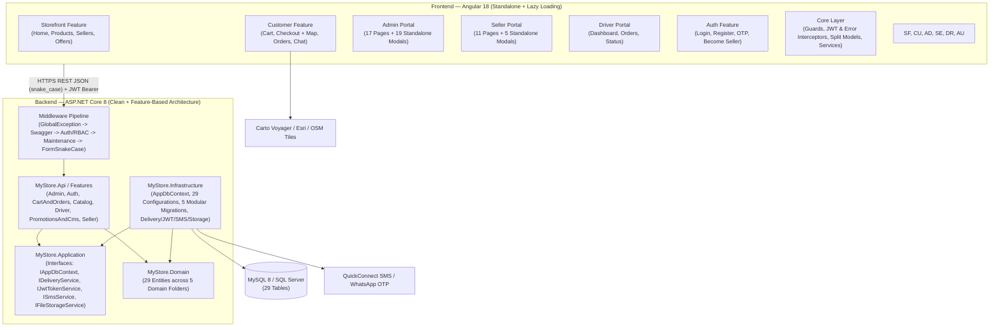
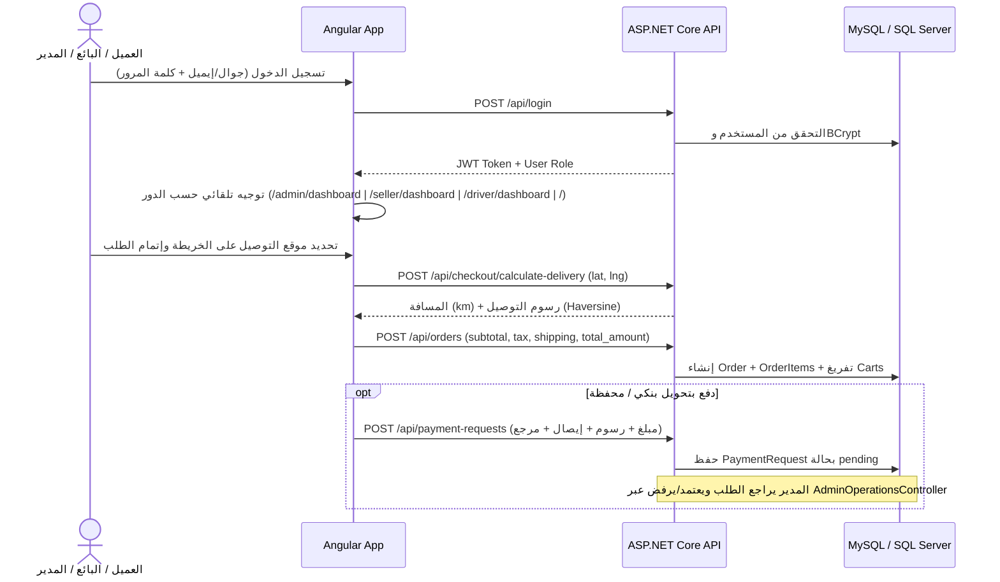

# System Architecture Documentation

يوثق هذا الملف البنية الهندسية الكاملة للمنصة (**Backend .NET 8** + **Frontend Angular 18**)، وتدفقات الأمان والطلبات، والأنظمة المالية والمحاسبية.

---

## 1. النظرة العامة والمعمارية الطبقية (High-Level Architecture)



---

## 2. معمارية الواجهة الخلفية (`backend-dotnet/`)

تجمع الواجهة الخلفية بين **Clean Architecture** (فصل المسؤوليات إلى 4 مشاريع) و**Feature-Based Architecture** داخل طبقة الـ API:

### أ. المشاريع والطبقات الأربعة
1. **`MyStore.Domain`**:
   - يحتوي على **29 كياناً** مقسمة حسب النطاق:
     - `Entities/Users/`: `User`, `Seller`, `Driver`, `AdminAudit`
     - `Entities/Catalog/`: `Activity`, `Category`, `SellerCategory`, `Product`, `ProductVariant`, `VariantOption`, `Review`, `Wishlist`
     - `Entities/OrderAndCart/`: `Cart`, `Order`, `OrderItem`
     - `Entities/FinanceAndPromo/`: `Coupon`, `Offer`, `OfferProduct`, `Tax`, `ShippingCompany`, `PaymentMethod`, `PaymentRequest`
     - `Entities/CommunicationAndCms/`: `Message`, `Notification`, `Banner`, `Setting`, `Policy`, `AboutUs`, `ContactUs`
2. **`MyStore.Application`**:
   - العقود المجردة (`Interfaces/`): `IAppDbContext`, `IDeliveryService`, `IJwtTokenService`, `IFileStorageService`, `ISmsService`.
3. **`MyStore.Infrastructure`**:
   - **`Persistence/AppDbContext.cs`**: يطبّق الإعدادات تلقائياً عبر `ApplyConfigurationsFromAssembly`.
   - **`Persistence/Configurations/`**: **29 ملف `IEntityTypeConfiguration<T>`** منفصل (ملف لكل جدول).
   - **`Migrations/`**: **5 ملفات Migrations مستقلة** حسب الوحدة الوظيفية (`202611190001_CreateUsersAndRolesTables` حتى `202611190005_CreateCommunicationAndCmsTables`) + `AppDbContextModelSnapshot.cs`.
   - **`Services/`**:
     - `JwtTokenService`: توليد وتوقيع رموز JWT متضمنة الدور (`role`) و`NameIdentifier`.
     - `DeliveryService`: حساب المسافة الجغرافية والرسوم عبر معادلة **Haversine**.
     - `QuickConnectSmsService`: إرسال رموز التحقق OTP عبر الواتساب/SMS وتطبيع أرقام الهواتف.
     - `FileStorageService`: حفظ وإدارة الملفات المرفوعة محلياً تحت `wwwroot/`.
   - **دعم قاعدتي بيانات**: التبديل المرن بين **MySQL (Pomelo)** و**SQL Server** عبر مفتاح `DatabaseProvider` في `appsettings.json`.
4. **`MyStore.Api`**:
   - **`Features/`** مقسمة إلى 7 وحدات مستقلة (كل وحدة تحتوي على `Controllers/` و`Dtos/`):
     - `Admin` (12 Controller — من لوحة القيادة حتى العمليات المالية والمحتوى)
     - `Seller` (7 Controllers — الكتالوج، الطلبات، التسويق، التواصل، التقارير، الإعدادات)
     - `Auth`, `CartAndOrders`, `Catalog`, `Driver`, `PromotionsAndCms`.
   - **`Middleware/`**:
     - `GlobalExceptionMiddleware`: توحيد استجابات الأخطاء JSON ومعالجة الاستثناءات.
     - `MaintenanceMiddleware`: تفعيل وضع الصيانة مع استثناء الإدارة.
     - `FormSnakeCaseMiddleware`: مواءمة أسماء حقول `multipart/form-data` بين الواجهة والباكيند.

---

## 3. معمارية الواجهة الأمامية (`frontend-angular/`)

مبنية بـ **Angular 18 Standalone Components** بدون NgModules، مع تقسيم صارم حسب الميزات (**Feature-Based Architecture**):

```text
src/app/
├── core/
│   ├── guards/          # authGuard & roleGuard (admin, seller, driver)
│   ├── interceptors/    # jwtInterceptor & errorInterceptor
│   ├── models/          # Split by domain: user, catalog, order, marketing, settings (+ barrel models.ts)
│   └── services/        # admin, auth, cart, driver, seller, storefront, toast
├── shared/
│   ├── components/      # LocationPickerComponent (Leaflet + Carto/Esri/OSM), ProductCardComponent
│   ├── constants/       # order-status.ts
│   ├── layouts/         # AdminLayout & SellerLayout (Accordion Sidebars), CustomerLayout, DriverLayout
│   └── utils/           # image.utils.ts
└── features/            # Lazy-Loaded via loadChildren in app.routes.ts
    ├── admin/           # 19 Pages + 19 Standalone Modals (components/modals/)
    ├── seller/          # 11 Pages + 5 Standalone Modals (components/modals/)
    ├── driver/          # 4 Pages (Dashboard, Orders, OrderDetails, Settings)
    ├── customer/        # 10 Pages (Cart, Checkout, Orders, Tracking, Wishlist, Account, Chat, ...)
    ├── storefront/      # 11 Pages + ProductImageModalComponent (numericSellerMatcher for /seller/:id)
    └── auth/            # 4 Pages (Login, Register, ForgotPassword, BecomeSeller)
```

---

## 4. تدفق المصادقة والطلبات والدفع (Sequence Diagram)



---

## 5. الأنظمة المالية والمحاسبية والتشغيلية
- **تجزئة الفاتورة في الطلب (`Order`)**: فصل `subtotal`، `tax`، `shipping`، و`total_amount` بدقة عشرية `decimal(10,2)`.
- **نظام الضرائب (`Tax`)**: يدعم الضريبة النسبية أو الثابتة، الضريبة الافتراضية، وربط ضريبة خاصة على مستوى المنتج (`products.tax_id`).
- **طرق وطلبات الدفع (`PaymentMethod` & `PaymentRequest`)**: عمولات/رسوم لكل وسيلة دفع، دورة تدقيق الإيصالات المصورة (`pending` -> `approved`/`rejected`)، وإحصائيات المبالغ.
- **التسعير الجغرافي للتوصيل (`DeliveryService`)**: يعتمد على `BaseFee`، `BaseDistanceKm`، و`PricePerKm` مع تقريب المسافة عبر معادلة Haversine.
- **لوحات القيادة والتقارير**:
  - **المدير (`AdminDashboardController`)**: إحصائيات فورية، تدفقات زمنية (اليوم/الأسبوع/الشهر/العام)، أداء البائعين، المنتجات الأكثر مبيعاً، وتصدير CSV.
  - **البائع (`SellerReportsController`)**: مؤشرات الأداء KPIs، منحنى اتجاهات المبيعات (`daily`/`weekly`/`monthly`)، صافي الأرباح بعد عمولة المنصة، وتصدير CSV.
