# Entity Relationship Diagram (ERD) & Data Dictionary

هذا المستند يوثق بشكل كامل ودقيق مخطط قاعدة البيانات (**29 جدولاً**) وعلاقاتها وفهارسها كما هي معرّفة في `MyStore.Domain`، `MyStore.Infrastructure/Persistence/Configurations/`، والـ **5 Migrations** المنفصلة.

---

## 1. مخطط العلاقات الكامل (Mermaid ERD — 29 Tables)

```mermaid
erDiagram
    %% ===== 1. Users & Roles =====
    users {
        bigint_unsigned id PK
        varchar name
        varchar first_name
        varchar last_name
        varchar email
        datetime email_verified_at
        varchar password
        varchar phone
        varchar role
        tinyint is_active
        longtext address
        varchar city
        varchar country
        varchar postal_code
        tinyint is_online
        varchar work_zone
        decimal latitude
        decimal longitude
        varchar remember_token
        datetime created_at
        datetime updated_at
    }

    sellers {
        bigint_unsigned id PK
        bigint_unsigned user_id FK
        varchar store_name
        longtext description
        longtext avatar
        longtext avatar_image
        longtext cover_image
        varchar type
        decimal rating
        int reviews_count
        varchar status
        tinyint is_verified
        tinyint is_open
        tinyint accepting_orders
        varchar preparation_time
        decimal min_order_amount
        longtext working_hours
        varchar cuisine_type
        longtext address
        varchar city
        decimal latitude
        decimal longitude
        longtext id_card_image
        longtext commercial_register_image
        longtext signed_contract_image
        varchar kuraimi_account_number
        varchar kuraimi_account_name
        varchar alt_network_name
        varchar alt_recipient_name
        varchar alt_recipient_phone
        datetime created_at
        datetime updated_at
    }

    drivers {
        bigint_unsigned id PK
        bigint_unsigned user_id FK
        longtext personal_photo
        varchar emergency_contact_phone
        varchar vehicle_type
        varchar vehicle_plate_number
        longtext id_card_image
        varchar kuraimi_account
        tinyint is_verified
        datetime created_at
        datetime updated_at
    }

    admin_audits {
        bigint_unsigned id PK
        bigint_unsigned admin_id FK
        varchar action
        varchar path
        varchar ip_address
        longtext user_agent
        longtext details
        datetime created_at
    }

    %% ===== 2. Catalog =====
    activities {
        bigint_unsigned id PK
        varchar name
        varchar slug UK
        varchar icon
        longtext description
        varchar banner_title
        varchar banner_subtitle
        varchar banner_bg
        longtext banner_image
        varchar place_label
        varchar item_label
        tinyint is_active
        int sort_order
        datetime created_at
        datetime updated_at
    }

    categories {
        bigint_unsigned id PK
        varchar name
        varchar type
        varchar slug UK
        longtext description
        longtext image
        longtext image_url
        bigint_unsigned parent_id FK
        tinyint is_active
        tinyint show_on_homepage
        int sort_order
        datetime created_at
        datetime updated_at
    }

    seller_categories {
        bigint_unsigned id PK
        bigint_unsigned seller_id FK
        varchar name
        varchar slug
        longtext description
        varchar icon
        tinyint is_active
        int sort_order
        datetime created_at
        datetime updated_at
    }

    products {
        bigint_unsigned id PK
        varchar name
        varchar slug UK
        longtext description
        longtext detailed_description
        decimal price
        decimal compare_at_price
        decimal sale_price
        datetime sale_start_date
        datetime sale_end_date
        varchar currency
        varchar sku UK
        int stock
        longtext image_url
        longtext images
        longtext gallery_images
        longtext food_options
        longtext variants
        int preparation_time
        varchar condition
        bigint_unsigned category_id FK
        bigint_unsigned seller_category_id FK
        bigint_unsigned seller_id FK
        bigint_unsigned tax_id FK
        varchar seller_name
        longtext seller_avatar
        decimal seller_rating
        int seller_reviews_count
        decimal rating
        int reviews_count
        int sold_count
        tinyint is_featured
        tinyint is_active
        tinyint is_approved
        datetime created_at
        datetime updated_at
    }

    product_variants {
        bigint_unsigned id PK
        bigint_unsigned product_id FK
        varchar name
        decimal price
        tinyint is_active
        datetime created_at
        datetime updated_at
    }

    variant_options {
        bigint_unsigned id PK
        bigint_unsigned product_variant_id FK
        varchar name
        decimal price
        datetime created_at
        datetime updated_at
    }

    reviews {
        bigint_unsigned id PK
        bigint_unsigned user_id FK
        bigint_unsigned product_id FK
        int rating
        longtext comment
        tinyint is_verified_purchase
        tinyint is_approved
        datetime created_at
        datetime updated_at
    }

    wishlists {
        bigint_unsigned id PK
        bigint_unsigned user_id FK
        bigint_unsigned product_id FK
        datetime created_at
        datetime updated_at
    }

    %% ===== 3. Orders & Cart =====
    carts {
        bigint_unsigned id PK
        bigint_unsigned user_id FK
        bigint_unsigned product_id FK
        bigint_unsigned product_variant_id FK
        int quantity
        varchar product_name
        decimal price
        longtext image_url
        varchar sku
        decimal weight
        varchar dimensions
        varchar category
        varchar brand
        longtext description
        longtext short_description
        varchar status
        tinyint featured
        longtext variant_attributes
        varchar currency
        varchar color
        varchar color_code
        varchar size
        varchar variant_name
        varchar variant_value
        int selected_image_index
        longtext selected_options
        longtext special_instructions
        varchar seller_type
        datetime created_at
        datetime updated_at
    }

    orders {
        bigint_unsigned id PK
        bigint_unsigned user_id FK
        varchar order_number UK
        decimal total_amount
        decimal subtotal
        decimal tax
        decimal shipping
        varchar status
        varchar payment_status
        varchar payment_method
        varchar shipping_company
        longtext shipping_address
        longtext billing_address
        longtext notes
        decimal latitude
        decimal longitude
        longtext formatted_address
        longtext building_details
        bigint_unsigned driver_id FK
        varchar driver_status
        datetime created_at
        datetime updated_at
    }

    order_items {
        bigint_unsigned id PK
        bigint_unsigned order_id FK
        bigint_unsigned product_id FK
        bigint_unsigned product_variant_id FK
        varchar product_name
        varchar product_sku
        int quantity
        decimal price
        decimal total
        varchar color
        varchar color_code
        varchar size
        varchar variant_name
        varchar variant_value
        int selected_image_index
        longtext selected_options
        longtext special_instructions
        datetime created_at
        datetime updated_at
    }

    %% ===== 4. Finance & Promotions =====
    coupons {
        bigint_unsigned id PK
        bigint_unsigned seller_id FK
        varchar code UK
        varchar name
        longtext description
        varchar type
        decimal value
        decimal minimum_amount
        int usage_limit
        int used_count
        datetime starts_at
        datetime expires_at
        tinyint is_active
        datetime created_at
        datetime updated_at
    }

    offers {
        bigint_unsigned id PK
        bigint_unsigned seller_id FK
        varchar title
        varchar slug UK
        longtext description
        decimal original_price
        decimal discount_price
        decimal discount_percentage
        longtext image
        longtext banner
        longtext thumbnail
        datetime start_date
        datetime end_date
        tinyint featured
        tinyint active
        varchar status
        datetime created_at
        datetime updated_at
    }

    offer_products {
        bigint_unsigned id PK
        bigint_unsigned offer_id FK
        bigint_unsigned product_id FK
        datetime created_at
        datetime updated_at
    }

    taxes {
        bigint_unsigned id PK
        varchar name
        longtext description
        decimal rate
        varchar type
        tinyint is_active
        tinyint is_default
        datetime start_date
        datetime end_date
        datetime created_at
        datetime updated_at
    }

    shipping_companies {
        bigint_unsigned id PK
        varchar name
        varchar code UK
        longtext description
        decimal cost
        tinyint is_active
        varchar delivery_days
        longtext tracking_url
        datetime created_at
        datetime updated_at
    }

    payment_methods {
        bigint_unsigned id PK
        varchar name
        varchar code UK
        longtext description
        decimal fee
        tinyint is_active
        longtext config
        varchar icon
        longtext icon_image
        datetime created_at
        datetime updated_at
    }

    payment_requests {
        bigint_unsigned id PK
        bigint_unsigned order_id FK
        bigint_unsigned user_id FK
        varchar payment_method
        varchar payment_method_name
        varchar payer_name
        varchar reference_number
        varchar phone_number
        longtext payment_notes
        longtext payment_image_path
        decimal payment_amount
        decimal payment_fee
        varchar status
        longtext admin_notes
        datetime payment_date
        datetime created_at
        datetime updated_at
    }

    %% ===== 5. Communication & CMS =====
    messages {
        bigint_unsigned id PK
        bigint_unsigned customer_id FK
        bigint_unsigned seller_id FK
        bigint_unsigned product_id FK
        bigint_unsigned order_id FK
        varchar sender_type
        longtext message
        longtext reply
        varchar status
        datetime replied_at
        datetime created_at
        datetime updated_at
    }

    notifications {
        bigint_unsigned id PK
        bigint_unsigned user_id FK
        varchar type
        varchar title
        longtext message
        longtext data
        tinyint read
        datetime read_at
        longtext link
        datetime created_at
        datetime updated_at
    }

    banners {
        bigint_unsigned id PK
        varchar title
        longtext description
        longtext image_url
        longtext link_url
        varchar link_text
        tinyint is_active
        int sort_order
        varchar position
        varchar type
        datetime created_at
        datetime updated_at
    }

    settings {
        bigint_unsigned id PK
        longtext store_name
        longtext store_description
        longtext store_logo
        longtext store_favicon
        longtext store_email
        longtext store_phone
        longtext store_address
        tinyint allow_registration
        tinyint allow_guest_checkout
        int order_start_number
        tinyint maintenance_mode
        longtext delivery_zones
        datetime created_at
        datetime updated_at
    }

    policies {
        bigint_unsigned id PK
        varchar type UK
        varchar title
        longtext description
        longtext content
        tinyint is_active
        datetime created_at
        datetime updated_at
    }

    about_us {
        bigint_unsigned id PK
        varchar title
        longtext content
        longtext image
        longtext mission
        longtext vision
        longtext values
        longtext team_members
        longtext statistics
        tinyint is_active
        datetime created_at
        datetime updated_at
    }

    contact_us {
        bigint_unsigned id PK
        varchar name
        varchar email
        varchar phone
        varchar subject
        longtext message
        varchar status
        longtext admin_notes
        datetime replied_at
        datetime created_at
        datetime updated_at
    }

    %% ===== RELATIONSHIPS =====
    users ||--o| sellers : "owns store/restaurant"
    users ||--o| drivers : "has driver profile"
    users ||--o{ admin_audits : "performs audit"
    users ||--o{ reviews : "writes"
    users ||--o{ wishlists : "saves"
    users ||--o{ carts : "has items"
    users ||--o{ orders : "places"
    users ||--o{ orders : "delivers (driver_id)"
    users ||--o{ payment_requests : "submits"
    users ||--o{ messages : "sends (customer_id)"
    users ||--o{ notifications : "receives"

    categories ||--o{ categories : "parent_id hierarchy"
    categories ||--o{ products : "categorizes"
    sellers ||--o{ seller_categories : "defines"
    sellers ||--o{ products : "sells"
    sellers ||--o{ coupons : "creates"
    sellers ||--o{ offers : "launches"
    sellers ||--o{ messages : "receives"

    seller_categories ||--o{ products : "groups"
    taxes ||--o{ products : "tax_id applies to"

    products ||--o{ product_variants : "has variants"
    products ||--o{ reviews : "receives"
    products ||--o{ wishlists : "wishlisted in"
    products ||--o{ carts : "added to"
    products ||--o{ order_items : "ordered in"
    products ||--o{ offer_products : "included in"
    products ||--o{ messages : "referenced in"

    product_variants ||--o{ variant_options : "has options"
    product_variants ||--o{ carts : "selected in"
    product_variants ||--o{ order_items : "ordered with"

    orders ||--o{ order_items : "contains"
    orders ||--o{ payment_requests : "paid via"
    orders ||--o{ messages : "discussed in"

    offers ||--o{ offer_products : "links"
```

---

## 2. قاموس البيانات التفصيلي حسب الـ Migrations (Data Dictionary)

تم تقسيم قاعدة البيانات إلى **5 وحدات/Migrations مستقلة** لضمان سهولة التطوير والصيانة:

### الوحدة 1: `202611190001_CreateUsersAndRolesTables` (المستخدمون والأدوار)
| الجدول | الغرض | المفاتيح والعلاقات الرئيسية | الفهارس |
| :--- | :--- | :--- | :--- |
| `users` | حسابات كافة المستخدمين (`customer`, `seller`, `driver`, `admin`) | `id` (PK)، إحداثيات GPS (`latitude`, `longitude`) | `email`, `phone`, `role` |
| `sellers` | ملفات المتاجر والمطاعم ووثائق التوثيق والحسابات البنكية (الكريمي/الشبكات) | `user_id` -> `users.id` (`SET NULL`) | `user_id`, `status`, `type` |
| `drivers` | ملفات مندوبي التوصيل (المركبة، اللوحة، الهوية، حساب الكريمي) | `user_id` -> `users.id` (`CASCADE`) | `user_id` |
| `admin_audits` | سجل الرقابة والتدقيق لجميع عمليات الإدارة | `admin_id` -> `users.id` (`CASCADE`) | `admin_id`, `action`, `created_at` |

### الوحدة 2: `202611190002_CreateCatalogTables` (الكتالوج والمنتجات)
| الجدول | الغرض | المفاتيح والعلاقات الرئيسية | الفهارس |
| :--- | :--- | :--- | :--- |
| `activities` | الأنشطة التجارية الديناميكية (متاجر، مطاعم، إلخ) | `id` (PK) | `slug` (Unique), `is_active` |
| `categories` | التصنيفات الرئيسية والفرعية الهرمية | `parent_id` -> `categories.id` (`SET NULL`) | `slug` (Unique), `parent_id`, `type` |
| `seller_categories` | تصنيفات داخلية خاصة بكل بائع/مطعم | `seller_id` -> `sellers.id` (`CASCADE`) | `seller_id` |
| `products` | المنتجات والوجبات والأسعار والعروض والمخزون | `category_id` -> `categories.id` (`CASCADE`)، `seller_id` -> `sellers.id` (`SET NULL`)، `seller_category_id` -> `seller_categories.id` (`SET NULL`)، `tax_id` -> `taxes.id` (`SET NULL`) | `slug` (Unique), `sku`, `category_id`, `seller_id`, `seller_category_id`, `tax_id`, `is_active`, `is_featured` |
| `product_variants` | متغيرات المنتج (مثل الحجم، اللون) | `product_id` -> `products.id` (`CASCADE`) | `product_id` |
| `variant_options` | خيارات كل متغير وأسعاره | `product_variant_id` -> `product_variants.id` (`CASCADE`) | `product_variant_id` |
| `reviews` | تقييمات وتعليقات العملاء على المنتجات | `user_id` -> `users.id` (`CASCADE`)، `product_id` -> `products.id` (`CASCADE`) | `user_id`, `product_id` |
| `wishlists` | قائمة المفضلة للعميل | `user_id` -> `users.id` (`CASCADE`)، `product_id` -> `products.id` (`CASCADE`) | `(user_id, product_id)` (Unique), `product_id` |

### الوحدة 3: `202611190003_CreateOrdersAndCartTables` (السلة والطلبات)
| الجدول | الغرض | المفاتيح والعلاقات الرئيسية | الفهارس |
| :--- | :--- | :--- | :--- |
| `carts` | سلة التسوق مع حفظ المتغيرات والخيارات والوزن (`decimal(8,2)`) والحالة | `user_id` -> `users.id` (`CASCADE`)، `product_id` -> `products.id` (`CASCADE`)، `product_variant_id` -> `product_variants.id` (`SET NULL`) | `user_id`, `product_id`, `product_variant_id` |
| `orders` | الطلبات مع التفصيل المحاسبي (`subtotal`, `tax`, `shipping`, `total_amount`) والموقع | `user_id` -> `users.id` (`CASCADE`)، `driver_id` -> `users.id` (`SET NULL`) | `order_number` (Unique), `user_id`, `driver_id`, `status` |
| `order_items` | بنود الفاتورة لكل طلب مع الكمية والسعر والخيارات المختارة | `order_id` -> `orders.id` (`CASCADE`)، `product_id` -> `products.id` (`CASCADE`)، `product_variant_id` -> `product_variants.id` (`SET NULL`) | `order_id`, `product_id`, `product_variant_id` |

### الوحدة 4: `202611190004_CreateFinanceAndPromoTables` (المالية والمحاسبة والعروض)
| الجدول | الغرض | المفاتيح والعلاقات الرئيسية | الفهارس |
| :--- | :--- | :--- | :--- |
| `coupons` | كوبونات الخصم (نسبة مئوية أو مبلغ ثابت) وحدود الاستخدام | `seller_id` -> `sellers.id` (`CASCADE`) | `code` (Unique), `seller_id` |
| `offers` | العروض الترويجية للمتاجر والمنصة | `seller_id` -> `sellers.id` (`CASCADE`) | `slug` (Unique), `seller_id` |
| `offer_products` | ربط العروض بالمنتجات (Many-to-Many) | `offer_id` -> `offers.id` (`CASCADE`)، `product_id` -> `products.id` (`CASCADE`) | `(offer_id, product_id)` (Unique), `product_id` |
| `taxes` | نظام الضرائب المرن (نسبة/ثابت، افتراضي، فترات صلاحية) | `id` (PK) + مرتبط بـ `products.tax_id` | — |
| `shipping_companies` | شركات الشحن وتكاليفها وروابط التتبع | `id` (PK) | `code` (Unique) |
| `payment_methods` | طرق الدفع المتاحة وعمولة/رسوم كل طريقة (`fee`) وإعداداتها | `id` (PK) | `code` (Unique) |
| `payment_requests` | طلبات تأكيد الدفع والتحويلات وإيصالاتها (`pending`/`approved`/`rejected`) | `order_id` -> `orders.id` (`SET NULL`)، `user_id` -> `users.id` (`SET NULL`) | `order_id`, `user_id` |

### الوحدة 5: `202611190005_CreateCommunicationAndCmsTables` (التواصل والمحتوى والنظام)
| الجدول | الغرض | المفاتيح والعلاقات الرئيسية | الفهارس |
| :--- | :--- | :--- | :--- |
| `messages` | المحادثات المباشرة بين العملاء والبائعين حول المنتجات والطلبات | `customer_id` -> `users.id` (`CASCADE`)، `seller_id` -> `sellers.id` (`CASCADE`)، `product_id` -> `products.id` (`SET NULL`)، `order_id` -> `orders.id` (`SET NULL`) | `customer_id`, `seller_id`, `product_id`, `order_id` |
| `notifications` | الإشعارات الفورية للمستخدمين والبائعين | `user_id` -> `users.id` (`CASCADE`) | `user_id` |
| `banners` | البنرات الإعلانية في الصفحة الرئيسية حسب النشاط والموضع | `id` (PK) | — |
| `settings` | الإعدادات العامة للمنصة (الهوية، SEO، الأمان، وضع الصيانة، مناطق التوصيل) | `id` (PK) | — |
| `policies` | صفحات السياسات والشروط والخصوصية | `id` (PK) | `type` (Unique) |
| `about_us` | محتوى صفحة "من نحن" والرؤية والرسالة وفريق العمل | `id` (PK) | — |
| `contact_us` | رسائل الزوار عبر نموذج "تواصل معنا" وحالة الرد عليها | `id` (PK) | — |
